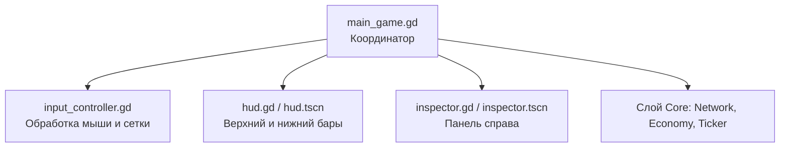

# Анализ архитектуры и план рефакторинга

В этом документе представлен подробный анализ текущей структуры кодовой базы проекта, оценка ответственности файлов, план по разделению логики «божественного класса» `main_game.gd` и общие рекомендации по улучшению архитектуры игры.

---

## 1. Обзор файлов проекта и объема кода

Ниже приведена таблица с распределением строк кода по файлам (на основе анализа репозитория):

| Путь к файлу | Кол-во строк | Слой | Основная ответственность | Статус / Вердикт |
| :--- | :---: | :---: | :--- | :--- |
| [`scripts/core/benchmark.gd`](file:///c:/MyThings/Projects/Godot/my-divine-with-antigravity-1/scripts/core/benchmark.gd) | 261 | Core | Стресс-тестирование, проверка симуляции и экономики | **OK**. Чистый скрипт для отладки и верификации. |
| [`scripts/core/building_data.gd`](file:///c:/MyThings/Projects/Godot/my-divine-with-antigravity-1/scripts/core/building_data.gd) | 138 | Core | Модель данных здания, логика потребления/производства ресурсов | **Отлично**. Узкая зона ответственности, нет завязки на визуальный слой. |
| [`scripts/core/economy_manager.gd`](file:///c:/MyThings/Projects/Godot/my-divine-with-antigravity-1/scripts/core/economy_manager.gd) | 167 | Core | Баланс игрока, цены зданий, покупка/демонтаж | **Отлично**. Чистый менеджер состояния экономики. |
| [`scripts/core/factory_network.gd`](file:///c:/MyThings/Projects/Godot/my-divine-with-antigravity-1/scripts/core/factory_network.gd) | 213 | Core | Граф фабрики, кэширование связей, распределение ресурсов | **Отлично**. Оптимизирован под быстрый оффлайн-просчет. |
| [`scripts/core/recipes.gd`](file:///c:/MyThings/Projects/Godot/my-divine-with-antigravity-1/scripts/core/recipes.gd) | 137 | Core | Статическая база рецептов и типов зданий | **OK**. Простая база данных. |
| [`scripts/core/save_manager.gd`](file:///c:/MyThings/Projects/Godot/my-divine-with-antigravity-1/scripts/core/save_manager.gd) | 65 | Core | Сериализация и десериализация игры на диск | **Отлично**. Простая утилита. |
| [`scripts/core/simulation_ticker.gd`](file:///c:/MyThings/Projects/Godot/my-divine-with-antigravity-1/scripts/core/simulation_ticker.gd) | 90 | Core | Управление таймингом тиков, оффлайн-наверстывание (catch-up) | **Отлично**. Изолированная логика времени. |
| [`scripts/visual/game_camera.gd`](file:///c:/MyThings/Projects/Godot/my-divine-with-antigravity-1/scripts/visual/game_camera.gd) | 33 | Visual | Навигация по сцене (зум, перемещение камеры) | **Отлично**. Минималистичный специализированный скрипт. |
| [`scripts/visual/grid_renderer.gd`](file:///c:/MyThings/Projects/Godot/my-divine-with-antigravity-1/scripts/visual/grid_renderer.gd) | 60 | Visual | Процедурная отрисовка координатной сетки | **Отлично**. Управляет только графикой сетки. |
| [`scripts/visual/connection_renderer.gd`](file:///c:/MyThings/Projects/Godot/my-divine-with-antigravity-1/scripts/visual/connection_renderer.gd) | 62 | Visual | Отрисовка труб и анимированных потоков ресурсов | **Отлично**. Чисто графический эффект. |
| [`scripts/visual/building_visual.gd`](file:///c:/MyThings/Projects/Godot/my-divine-with-antigravity-1/scripts/visual/building_visual.gd) | 249 | Visual | Визуальная карточка здания на сетке, UI буферов и прогресса | **Приемлемо**. Верстка UI в коде раздувает файл, но логика сфокусирована. |
| [`scripts/visual/main_game.gd`](file:///c:/MyThings/Projects/Godot/my-divine-with-antigravity-1/scripts/visual/main_game.gd) | 937 | Visual/Controller | Координация симуляции, управление мышью, построение HUD и логика инспектора | ⚠️ **Требует рефакторинга** (Божественный класс). |

---

## 2. Проблема «Божественного класса» (`main_game.gd`)

Файл `main_game.gd` сосредоточил в себе **четыре разные ответственности**:
1. **Жизненный цикл игры и координация (Game Loop / Coordinator)**: Загрузка/сохранение, создание симуляторов (`SimulationTicker`, `EconomyManager`, `FactoryNetwork`), реакция на тики и обновление состояния.
2. **Ввод пользователя и режимы мыши (Input & Interaction Controller)**: Panning камеры, перетаскивание зданий, обработка кликов для постройки, связи и сноса, определение объекта под курсором.
3. **Генерация интерфейса (HUD / UI Builder)**: Создание верхнего бара, нижних кнопок-карточек с нуля через код (создание flat stylebox, лейблов, контейнеров), управление логикой скроллинга карточек мышью.
4. **Панель инспектора зданий (Building Inspector)**: Обновление текстового описания выбранного здания, динамическое переключение рецептов через `OptionButton`.

### Предлагаемый план разделения `main_game.gd`

Для снижения зацепления (coupling) и повышения читаемости логику `main_game.gd` можно разбить на следующие компоненты:

### 1. Вынесение UI в сцены Godot (`.tscn`)
Создание интерфейса через код занимает около **350+ строк** в `main_game.gd`. Использование визуального редактора Godot сэкономит кучу кода:
* **`res://scenes/hud.tscn` + `hud.gd`**: Будет содержать верхнюю панель ресурсов и нижний скролл-контейнер с кнопками-карточками. Скрипт принимает данные об экономике и обновляет цены/доступность кнопок. При нажатии на карточку эмитит сигнал `build_mode_requested(type)` или `demolish_mode_requested`.
* **`res://scenes/inspector.tscn` + `inspector.gd`**: Отдельная панель справа. Она слушает события выбора здания, обновляет текст с буферами и управляет списком рецептов. При смене рецепта эмитит сигнал `recipe_changed(building_id, recipe_idx)`.

### 2. Вынесение логики ввода в `input_controller.gd`
* Создать узел/скрипт `scripts/visual/input_controller.gd`.
* Перенести туда обработку мыши: `_unhandled_input()`, `_get_grid_position_under_mouse()`, `_get_building_id_under_mouse()`, состояния драга зданий (`_is_dragging_building`).
* Контроллер ввода будет управлять исключительно взаимодействием с сеткой и сообщать `MainGame` через сигналы о действиях игрока: `place_building_requested(pos)`, `move_building_requested(id, new_pos)`, `link_requested(from_id, to_id)`, `demolish_requested(id)`.

### 3. `main_game.gd` как чистый Координатор (Controller)
В файле останется около 200–250 строк. Он будет:
* Инициализировать компоненты.
* Реагировать на сигналы ввода от `InputController` (проверять баланс через `EconomyManager`, добавлять здания/связи в `FactoryNetwork`).
* Передавать изменения в UI-сцены (`HUD` и `Inspector`).
* Управлять автосохранением.

---

## 3. Отзыв о формирующейся архитектуре проекта

### Сильные стороны (Что сделано отлично):
1. **Полное разделение Core и Visual (Decoupling)**: Логика симуляции полностью изолирована от движка рендеринга Godot. Код в папке `scripts/core` оперирует чистыми классами (`RefCounted`), математикой и словарями. Это позволяет:
   * Запускать симуляцию в фоновом режиме на огромной скорости без лагов рендеринга.
   * Легко проводить offline-catchup (наверстывание времени при входе в игру) — игра мгновенно пересчитывает миллионы тиков за долю секунды.
   * Запускать модульные тесты и бенчмарки (как в `benchmark.gd`) прямо в консоли или через `SceneTree`.
2. **Кэширование связей**: В `FactoryNetwork` реализован отличный кэш `_connection_cache` и `_credits_producers`. Благодаря этому во время тиков симуляции мы не ищем связи по графу, а бежим по линейным массивам с прямыми ссылками на объекты. Это идеальное решение для Godot-симулятора фабрики.

### Точки роста (Что требует доработки):
1. **Хардкод метаданных зданий в визуальном слое**:
   * В `building_visual.gd` и `main_game.gd` цвета акцентов и текстовые описания зданий захардкожены через `match data.type`.
   * *Рекомендация*: Вынести эти метаданные (цвет, описание, имя для отображения) либо непосредственно в `Recipes` (например, добавить поля `color` и `description` в рецепты или структуру здания), либо создать отдельный конфигурационный файл `building_config.gd`. Визуальные классы должны просто читать эти свойства из конфигурации, а не знать про все типы зданий.
2. **Динамическое создание UI кодом**:
   * Создание сложных Flat Stylebox, прогресс-баров и карточек в коде ухудшает читаемость и усложняет верстку (например, изменение скругления углов или цвета требует кодинга). Сцены Godot (`.tscn`) с темами оформления (`Theme`) сделают проект масштабируемым.
3. **Прямое зацепление симуляции и рендеринга**:
   * Сейчас визуальные ноды зданий (`visuals_map`) создаются и удаляются вручную прямо в методах `main_game.gd` при изменении данных.
   * *Рекомендация*: Использовать подход «подписчик-издатель». Пусть `FactoryNetwork` или `MainGame` генерирует сигналы `building_added(b_data)` и `building_removed(b_id)`, а визуальные менеджеры сами подписываются на них и перерисовывают сцену. Это сделает код расширяемым.

---

## 4. Резюме и следующие шаги

* **Срочный рефакторинг**: Начать с выделения UI (`hud.tscn`/`inspector.tscn`) и переноса мышиного ввода в `input_controller.gd`. Это разгрузит `main_game.gd` более чем в 3 раза.
* **Масштабируемость**: Перенести цвета и описания зданий из `match` блоков в централизованную базу данных (внутри `Recipes` или нового `building_config.gd`).
